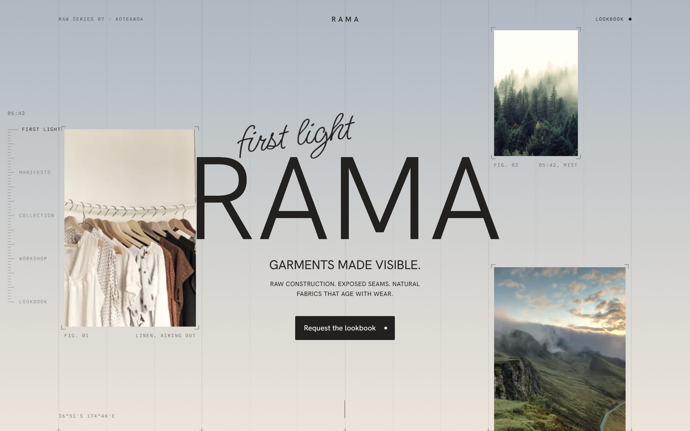

# RAMA

A concept site for a clothing label built around raw construction and exposed seams. The page runs through one day of light, from first light at 05:42 through to after dark, and the sky changes as you scroll.

Live at https://rama-nu.vercel.app

Built with Next.js, TypeScript, Tailwind CSS 4, GSAP and Lenis.

## Notes

Each chapter (first light, manifesto, collection, workshop, lookbook) has its own sky. The backdrop holds each one, then blends into the next over the last stretch of scroll, and the fixed header and ruler switch to whichever ink suits the chapter underneath them. The chapters and their colours are in `src/lib/content.ts`.

The background is a cutting-mat grid, 12 columns with every third line heavier, and the left edge is a tape-measure ruler that tracks where you are in the day.

The RAMA title runs each letter through an SVG displacement filter with a slight red and blue offset, all driven by one GSAP tween per letter.

Lenis runs off GSAP's ticker so the parallax and the scroll share a frame.

Type is Hanken Grotesk, with Ms Madi for the handwritten lines and IBM Plex Mono for labels.

It's a concept, so the lookbook form doesn't send anything, and the photos are placeholders from Unsplash and Pinterest.

## Running it

```bash
npm install
npm run dev
```
